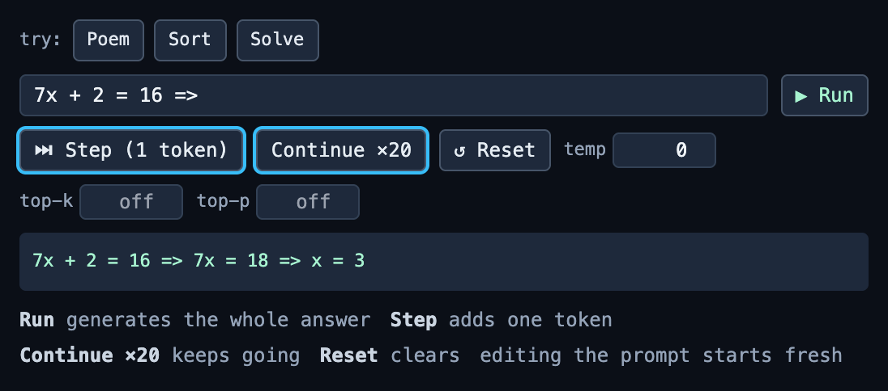
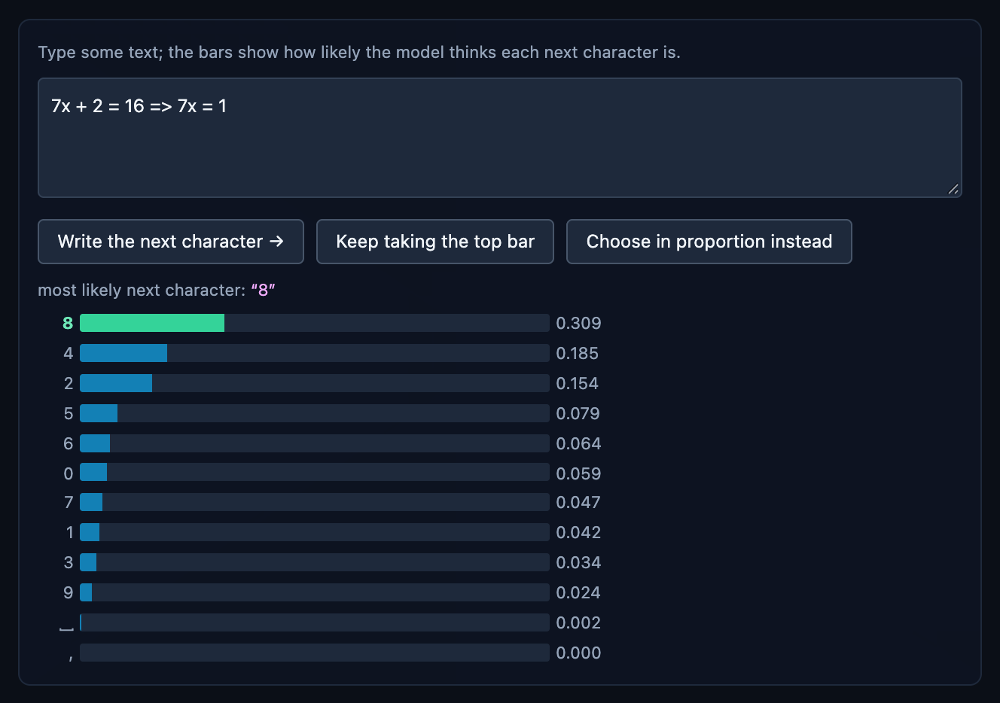

# Looks right, is wrong

*A dispatch from the series climbing from the smallest language model that does anything useful
to the ones in the headlines, one rung at a time, each with something you can run in your
browser.*

---

It has been a strange week. Researchers at MIT showed that a frontier model can read the weights
of a small neural network, say what it was trained to do, and write new weights by hand, with no
training at all. Within a day people were trying it on their own problems. One widely shared
result was a small network, written by a model in one go, that tells real legal citations from
fake ones at 97.8% on its test set.

It is a genuinely interesting result. It is also a good moment to ask a plainer question: what
can a checker like that actually see?

## A model that writes perfect-looking algebra

My demo model has about 90,000 parameters. Among other things, it was trained on simple algebra,
every line worked correctly and laid out the same way:

`7x + 2 = 16 => 7x = 14 => x = 2`

Ask it to solve that equation and here is what it writes:

The layout is perfect. The working is wrong from the first step: 16 minus 2 is 14, not 18. And
it is not a one-off:

I ran it on all 800 equations of the kind it was trained on. **94% of its answers look like valid
working. 8.4% are actually right.** Four in five of those equations were in its training text
word for word, and it gets those wrong just as often.

## The doubt never reaches the page

Here are the model's own probabilities at the moment it writes the wrong digit:

It picks 8 at 31%. The right answer, 4, is in second place at 18%. Inside, the model is close to
a coin toss. On the page there is only a clean, confident `18`.

That is the whole problem in miniature. The form of an answer comes from what the model has seen
many times. Whether the answer is true comes from somewhere else entirely, and the text carries
no sign of which one you are looking at.

## What a checker of form can catch

Suppose you built a checker for this model's algebra by looking only at the line. Is it the right
shape? Are the numbers in sensible ranges? It would pass 94% of these answers, nearly every one
of them wrong. To catch `7x = 18` you have to do the arithmetic: take 2 from 16 and see if you get
18. The check has to go to the thing the line is about.

Legal citations work the same way. A citation has a form: case name, volume, reporter, page. Some
fakes give themselves away in the form, a reporter that does not exist or a volume that was never
printed. A lookup catches the case that does not exist at all. Those are the easy ones.

The ones that end up in front of a judge look exactly right. A real case, cited at the wrong page.
A real case that does not say what it is cited for. A benchmark from Princeton this year sorts
citation errors into five kinds, from a case that does not exist to a real case misrepresented.
The models it tested were good at the first kind and none reliably caught the wrong page. A
second study, from Bloomberg, found models caught 93-100% of citations to the wrong case, but
only 37-61% of citations to the wrong page of the right case. When they missed, it was because
the case was on topic. In the authors' words, recognising the right topic and checking that a
source supports a specific proposition are different abilities.

So when a small network tells real citations from fake ones at 97.8%, the useful question is not
whether its weights were trained or written by hand. It is what the fakes in its test set looked
like. A checker that only ever sees the citation can only learn what fake citations look like.
The fakes that matter are the ones that look real.

## Checking against the content

For algebra, the fix is a calculator: the model proposes, something that actually does
arithmetic checks. That is what the harness on my site does.

For law, the equivalent is the content of the law itself, organised so it can be checked: each
point of law linked to the case that holds it, the page and passage where it is held, and the
later cases that followed it, distinguished it or overruled it. A knowledge graph of points of
law, in other words. With that, checking a citation stops being a judgement about how it looks
and becomes a lookup: does this case, at this page, hold this proposition, and is it still good
law?

There is a second reason to want the check outside the model. On a recent
[Latent Space episode](https://latent.space/p/building_legal_agents_when_you_can_t_see_the_data_-_jacob_lauritzen_cto_of_legora/),
a legal-AI builder described one model release taking their citation accuracy from 70% to 99%.
That is a remarkable jump. It also means the quality of any check built *into* a model moves
every time the model does. A check grounded in the source does not care which model wrote the
citation.

## Why this matters at work

If you are buying or building citation checking, ask one question: what does the check consult?
If the answer is the citation alone, it is checking form. That is worth having. It is not the
same as checking the law.

## The honest bit

My model is tiny, and frontier models get this algebra right. The point is not that big models
fail at arithmetic. It is that form and truth come from different places, and only a check
against the content can tell them apart. That holds at every size, as the two studies above
measure. I have not tested the citation network I mentioned and I am not claiming it fails. Its
figures are its author's own, and nothing published says how its fakes were made.

You can make my model do this yourself on
[JabberLM](https://jabberlm.com/explain?section=prediction&prompt=7x%20%2B%202%20%3D%2016%20%3D%3E%20):
press *Keep taking the top bar* and watch it write `7x = 18`, then carry on inventing equations of
its own in the same tidy layout.

---

*Where we are on the size ladder: **~90K parameters**, the same model as post 1. It writes
algebra that looks right 94% of the time and is right 8% of the time. Something like ten million
times smaller than the models in the headlines, and the same lesson applies to them.*
